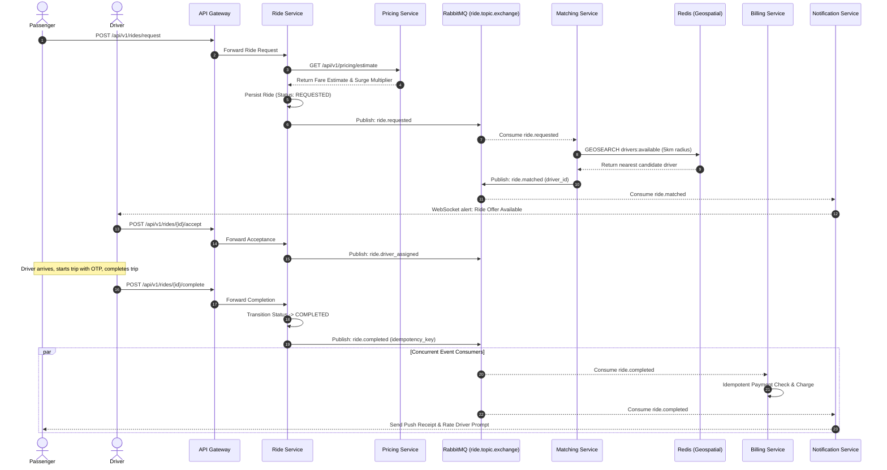
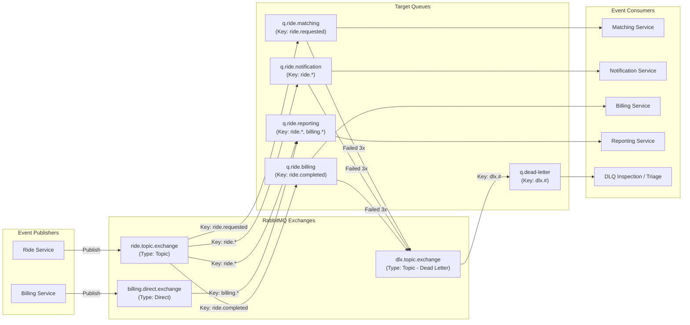
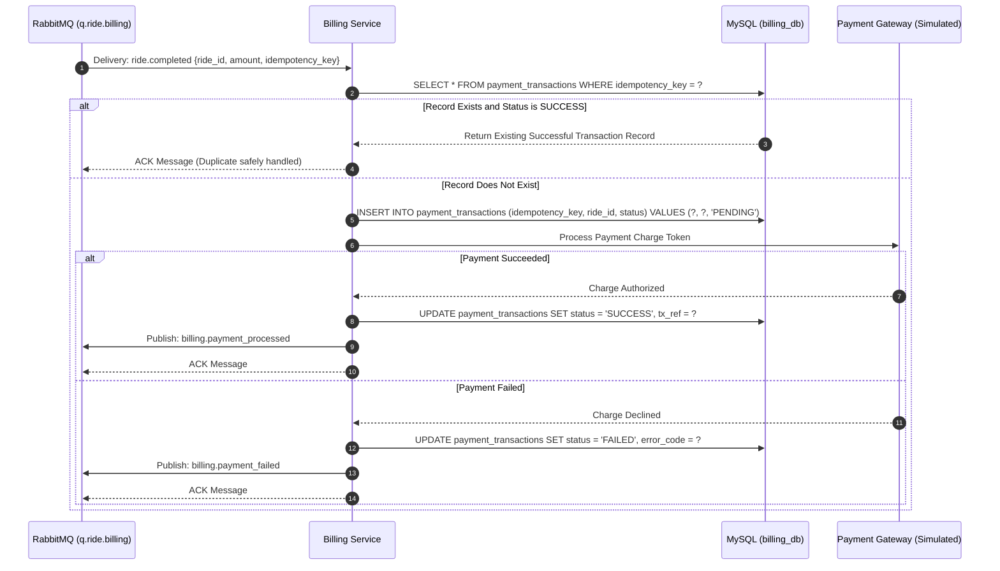
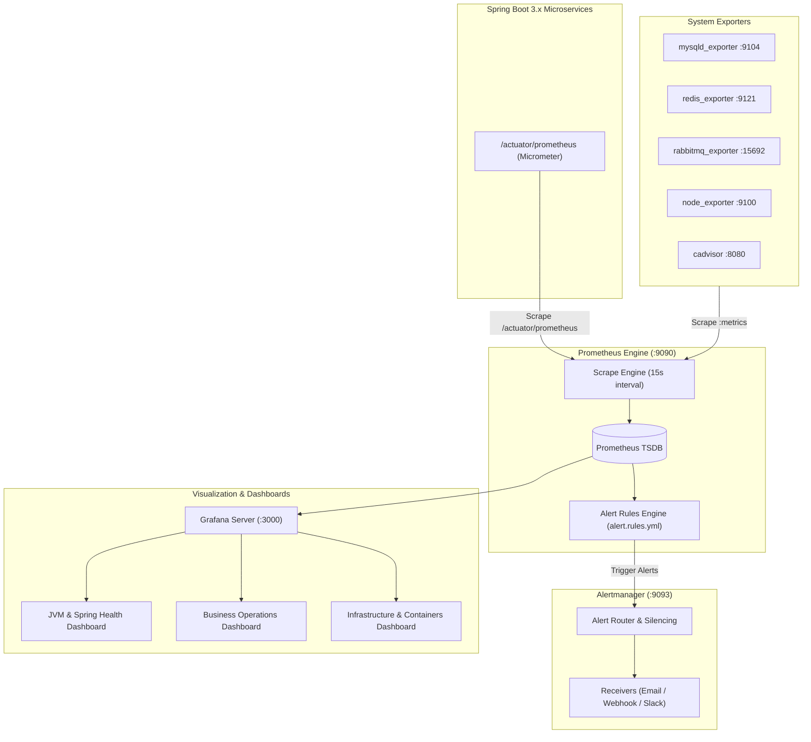

# System Architecture: Ride-Hailing DevOps & Microservices Platform

## 1. System Overview & Component Diagram

The **Ride-Hailing DevOps & Microservices Platform** is a distributed, event-driven architecture designed for high availability, fault tolerance, and comprehensive observability. It utilizes **Java 21** and **Spring Boot 3.x** across all services, **MySQL 8.x** for relational state persistence following the **Database-per-Service** pattern, **Redis 7.x** for geospatial driver tracking and gateway rate limiting, and **RabbitMQ 3.x** as the single message broker.

```mermaid
flowchart TD
    subgraph Clients["External Clients"]
        PassengerApp["Passenger Client (Web/Mobile)"]
        DriverApp["Driver Client (Web/Mobile)"]
    end

    subgraph IngressLayer["Edge & Ingress (Port 8080)"]
        K8sIngress["Nginx Ingress Controller"]
        ApiGateway["API Gateway (Spring Cloud Gateway :8080)"]
    end

    subgraph CoreServices["Java 21 / Spring Boot 3.x Microservices"]
        AuthService["Auth Service (:8081)"]
        PassengerService["Passenger Service (:8082)"]
        DriverService["Driver Service (:8083)"]
        RideService["Ride Service (:8084)"]
        MatchingService["Matching Service (:8085)"]
        PricingService["Pricing Service (:8086)"]
        BillingService["Billing Service (:8087)"]
        NotificationService["Notification Service (:8088)"]
        RatingService["Rating Service (:8089)"]
        ReportingService["Reporting Service (:8090)"]
    end

    subgraph StorageLayer["Data & State Storage (Database-per-Service)"]
        AuthDB[("Auth DB\n(MySQL :3306)")]
        PassengerDB[("Passenger DB\n(MySQL :3306)")]
        DriverDB[("Driver DB\n(MySQL :3306)")]
        RideDB[("Ride DB\n(MySQL :3306)")]
        PricingDB[("Pricing DB\n(MySQL :3306)")]
        BillingDB[("Billing DB\n(MySQL :3306)")]
        RatingDB[("Rating DB\n(MySQL :3306)")]
        ReportingDB[("Reporting DB\n(MySQL :3306)")]
        RedisStore[("Redis 7.x Cache & Geo\n(Port :6379)")]
    end

    subgraph MessagingLayer["Asynchronous Event Broker"]
        RabbitMQ["RabbitMQ 3.x Message Broker\n(Port :5672 / Mgmt :15672)"]
    end

    subgraph ObservabilityLayer["Observability & Telemetry"]
        Prometheus["Prometheus Server (:9090)"]
        Grafana["Grafana Dashboards (:3000)"]
        Alertmanager["Alertmanager (:9093)"]
        subgraph Exporters["System Exporters"]
            MySQLNode["mysqld_exporter (:9104)"]
            RedisNode["redis_exporter (:9121)"]
            RabbitNode["rabbitmq_exporter (:15692)"]
            HostNode["node_exporter (:9100)"]
            CadvNode["cadvisor (:8080)"]
        end
    end

    Clients -->|HTTPS / WSS| K8sIngress
    K8sIngress --> ApiGateway

    ApiGateway -->|Auth Validation| AuthService
    ApiGateway -->|Rate Limiting| RedisStore
    ApiGateway -->|/api/v1/passengers/*| PassengerService
    ApiGateway -->|/api/v1/drivers/*| DriverService
    ApiGateway -->|/api/v1/rides/*| RideService
    ApiGateway -->|/api/v1/pricing/*| PricingService
    ApiGateway -->|/api/v1/billing/*| BillingService
    ApiGateway -->|/api/v1/ratings/*| RatingService
    ApiGateway -->|/api/v1/reports/*| ReportingService

    AuthService --> AuthDB
    PassengerService --> PassengerDB
    DriverService --> DriverDB
    DriverService -->|GEOADD Location Pings| RedisStore
    RideService --> RideDB
    PricingService --> PricingDB
    BillingService --> BillingDB
    RatingService --> RatingDB
    ReportingService --> ReportingDB

    RideService -.->|Synchronous Fare Estimate| PricingService
    RideService -->|Publish Events| RabbitMQ
    RabbitMQ -->|Consume ride.requested| MatchingService
    MatchingService -->|GEOSEARCH Proximity Query| RedisStore
    MatchingService -->|Publish ride.matched| RabbitMQ
    RabbitMQ -->|Consume ride.matched / ride.completed| NotificationService
    RabbitMQ -->|Consume ride.completed| BillingService
    RabbitMQ -->|Consume ride.completed| RatingService
    RabbitMQ -->|Consume all events (ride.*, billing.*)| ReportingService

    CoreServices -.->|Expose /actuator/prometheus| Prometheus
    Exporters -.->|Expose Metrics| Prometheus
    Prometheus --> Grafana
    Prometheus -->|Alert Notifications| Alertmanager
```

---

## 2. Service Boundaries & Data Ownership

| Service Name | Port | Database / Cache | Owned Domain & Entities | Inbound Sync APIs | Outbound / Consumed Events |
| :--- | :---: | :--- | :--- | :--- | :--- |
| **API Gateway** | `8080` | Redis (rate limits) | Ingress routing, client rate limit buckets | External REST, WSS | Injects `X-User-Id`, `X-User-Role` |
| **Auth Service** | `8081` | MySQL `auth_db` | Users, Passwords (BCrypt), Roles, Refresh Tokens | `/api/v1/auth/*` | Issues signed JWTs |
| **Passenger Service** | `8082` | MySQL `passenger_db`| Passenger profiles, payment metadata, trip summaries | `/api/v1/passengers/*` | None (reads profile context) |
| **Driver Service** | `8083` | MySQL `driver_db`<br>Redis Geo | Driver records, vehicle info, status, live coordinates | `/api/v1/drivers/*` | Redis `GEOADD`, heartbeat TTL |
| **Ride Service** | `8084` | MySQL `ride_db` | Ride entity, FSM status, pickup/dropoff coords | `/api/v1/rides/*` | Publishes: `ride.requested`, `ride.started`, `ride.completed` |
| **Matching Service** | `8085` | Redis (read-only) | Proximity matching algorithm, candidate ranking | None (Worker) | Consumes: `ride.requested`<br>Publishes: `ride.matched` |
| **Pricing Service** | `8086` | MySQL `pricing_db` | Rate cards, geographic zones, surge multipliers | `/api/v1/pricing/*` | None (Synchronous query) |
| **Billing Service** | `8087` | MySQL `billing_db` | Payment transactions, receipts, idempotency keys | `/api/v1/billing/*` | Consumes: `ride.completed`<br>Publishes: `billing.payment_processed` |
| **Notification Service**| `8088`| In-Memory Sessions | Push/SMS alert logs, active WebSocket sessions | `/ws/rides/*` | Consumes: `ride.*`, `billing.*`<br>Dispatches live WebSockets |
| **Rating Service** | `8089` | MySQL `rating_db` | Passenger & driver reviews, 1-5 star ratings | `/api/v1/ratings/*` | Consumes: `ride.completed` |
| **Reporting Service** | `8090` | MySQL `reporting_db`| Denormalized daily business metrics, analytics | `/api/v1/reports/*` | Consumes: `ride.*`, `billing.*` |
| **Common DTO Module** | N/A | None | Shared Java 21 Records, event envelopes, errors | Library Dependency | Reusable across all services |

---

## 3. Ride & Payment Event Flows

### 3.1. End-to-End Trip Sequence Flow



### 3.2. RabbitMQ Exchange, Queue, and Dead-Letter Architecture



---

## 4. Redis Geospatial Architecture

Redis acts as the low-latency in-memory geospatial index for real-time driver coordinates:

1. **Ingestion & Indexing:**
   - Online drivers periodically emit GPS coordinates (`lat`, `lng`).
   - `driver-service` adds the position to the sorted geospatial set:
     ```redis
     GEOADD drivers:available <longitude> <latitude> <driver_id>
     ```
2. **Heartbeat & Stale Eviction Strategy:**
   - Concurrently with coordinate updates, `driver-service` sets a key with a 60-second TTL:
     ```redis
     SETEX driver:heartbeat:<driver_id> 60 "ONLINE"
     ```
   - When `matching-service` performs a proximity search, it filters candidates against the heartbeat key. Drivers without an active key are treated as offline and evicted from `drivers:available`.
3. **Proximity Search Query:**
   - Proximity search locates candidate drivers within a 5 km circle:
     ```redis
     GEOSEARCH drivers:available FROMLONLAT <pickup_lng> <pickup_lat> BYRADIUS 5 km ASC WITHDIST WITHCOORD COUNT 10
     ```
4. **State Transition Removal:**
   - When a driver accepts a ride or toggles offline, they are removed from the candidate pool:
     ```redis
     ZREM drivers:available <driver_id>
     DEL driver:heartbeat:<driver_id>
     ```

---

## 5. Idempotent Payment Architecture

To prevent duplicate charges caused by network drops, message broker redeliveries, or container restarts:



### Database Constraint Mechanics:
- The MySQL table enforces a `UNIQUE(idempotency_key)` constraint.
- If two consumers attempt to process the same payment concurrently, the database enforces single-record insertion. The loser catches `DuplicateKeyException` and reads the winning transaction record.

---

## 6. Docker Compose & Local Kubernetes Deployment

### 6.1. Multi-Stage Java 21 Containerization
Every microservice uses a multi-stage Docker build:
- **Build Stage:** `eclipse-temurin:21-jdk-jammy` with Maven dependency caching layer.
- **Runtime Stage:** `eclipse-temurin:21-jre-jammy`, non-root user (`appuser:10001`), container-aware JVM flags (`-XX:+UseZGC -XX:MaxRAMPercentage=75.0`).

### 6.2. Docker Compose Local Topology (`docker-compose.yml`)
The root Docker Compose file brings up the entire local ecosystem in one command:
- All 11 microservices with explicit health checks and dependency ordering (`depends_on: condition: service_healthy`).
- Supporting infrastructure: MySQL 8.x, Redis 7.x, RabbitMQ 3.x (with Management UI at port `15672`).
- Telemetry services: Prometheus (`9090`), Grafana (`3000`), Alertmanager (`9093`).
- System exporters: `mysqld_exporter` (`9104`), `redis_exporter` (`9121`), `rabbitmq_exporter` (`15692`), `node_exporter` (`9100`), `cadvisor` (`8080`).

### 6.3. Local-First Kubernetes Architecture (`minikube` / `kind`)
- **Namespaces:**
  - `ride-hailing-local`: Microservices, MySQL, Redis, RabbitMQ.
  - `monitoring`: Prometheus, Grafana, Alertmanager, Exporters.
- **Workload Specifications:**
  - Standardized resource requests (`cpu: 100m, memory: 256Mi`) and limits (`cpu: 500m, memory: 512Mi`).
  - Liveness probe: HTTP GET `/actuator/health/liveness` (initialDelay: 30s, period: 10s).
  - Readiness probe: HTTP GET `/actuator/health/readiness` (initialDelay: 20s, period: 5s).
  - Horizontal Pod Autoscalers (HPA) configured for high-traffic entry points (API Gateway, Ride Service).

---

## 7. Infrastructure as Code (Terraform) & Configuration Management (Ansible)

### 7.1. Terraform Architecture
- **Directory Structure:**
  - `terraform/modules/vpc`: Subnets, NAT Gateways, Internet Gateways, Security Groups.
  - `terraform/modules/kubernetes`: Managed cluster orchestration (EKS / KinD provider).
  - `terraform/modules/database`: RDS MySQL database definitions.
  - `terraform/environments/local`: Local infrastructure orchestration.
  - `terraform/environments/aws`: Target cloud definitions.
- **Safety Boundary & Human Approval Gate:**
  - Remote cloud provisioning (`terraform apply` and `terraform destroy`) on `terraform/environments/aws` **strictly requires human authorization**.
  - CI/CD pipelines run only `terraform validate` and `terraform plan`. Autonomous apply or destroy operations are strictly prohibited.

### 7.2. Ansible Configuration Architecture
- **Directory Structure:** `ansible/playbooks/`
  - `site.yml`: Master orchestration playbook.
  - `hardening.yml`: SSH security, UFW firewall rules, unprivileged user provisioning.
  - `container-runtime.yml`: Docker engine, containerd, and required system dependencies.

---

## 8. Full-Stack Observability & Telemetry Architecture



### 8.1. Ports & Endpoints Reference
| Component | Port | Endpoint / Metric Path | Description |
| :--- | :---: | :--- | :--- |
| **API Gateway** | `8080` | `/actuator/prometheus` | Ingress metrics, request rates, HTTP status codes |
| **Microservices** | `8081` - `8090` | `/actuator/prometheus` | JVM metrics, HikariCP pool, domain counters |
| **MySQL Server** | `3306` | Native TCP | Relational database instances |
| **Redis Server** | `6379` | Native TCP | In-memory cache & geospatial store |
| **RabbitMQ Broker** | `5672` / `15672` | AMQP / HTTP Web UI | Message queue broker & management interface |
| **Prometheus Server** | `9090` | `/api/v1/targets` | Metrics aggregator & time-series database |
| **Alertmanager** | `9093` | `/api/v2/status` | Alert deduplication, grouping, and notification routing |
| **Grafana Server** | `3000` | `/api/health` | Dashboard visualization and monitoring UI |
| **mysqld_exporter** | `9104` | `/metrics` | MySQL InnoDB buffer, connection pool, slow query metrics |
| **redis_exporter** | `9121` | `/metrics` | Redis memory consumption, keyspace, client metrics |
| **rabbitmq_exporter**| `15692`| `/metrics` | Queue depths, delivery rates, unacknowledged message counts |
| **node_exporter** | `9100` | `/metrics` | Host CPU, RAM, disk I/O, network bandwidth metrics |
| **cadvisor** | `8080` | `/metrics` | Container CPU throttling, memory limits, container health |

### 8.2. Key Business Metrics
- `rides_requested_total`: Counter tracking total booking attempts.
- `rides_completed_total`: Counter tracking successfully finished trips.
- `matching_duration_seconds`: Histogram measuring dispatch latency.
- `payment_failures_total`: Counter tracking payment exceptions.
- `active_drivers_count`: Real-time gauge of online available drivers.

### 8.3. Alertmanager Rules & Verification
- **High Error Rate Alert:** Triggered if HTTP 5xx responses exceed 5% over 5 minutes.
- **Service Down Alert:** Triggered if any instance reports `up == 0` for 1 minute.
- **DLQ Message Accumulation Alert:** Triggered if `q.dead-letter` message count > 0 for 5 minutes.
- **Validation Commands:**
  ```powershell
  # Promtool configuration & alert rule verification
  docker run --rm -v ${PWD}/monitoring/prometheus:/etc/prometheus prom/prometheus:v2.51.0 promtool check config /etc/prometheus/prometheus.yml
  docker run --rm -v ${PWD}/monitoring/prometheus:/etc/prometheus prom/prometheus:v2.51.0 promtool check rules /etc/prometheus/alert.rules.yml
  ```
