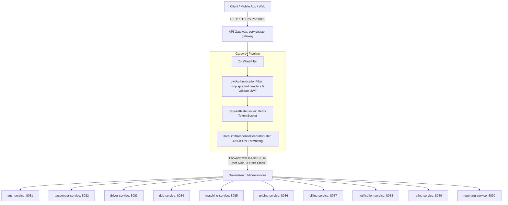

# Phase 7: API Gateway & Security Perimeter

## 1. Overview & Architecture

The **API Gateway** (`services/api-gateway`) serves as the single unified entry point and security perimeter for the Ride-Hailing Platform. Built on **Spring Cloud Gateway** (using the reactive Spring WebFlux/Netty stack), it sits in front of all 10 downstream microservices to provide:
- **Centralized Routing**: Explicit path mappings routing clients to downstream service ports.
- **Security Perimeter**: Non-blocking HMAC-SHA256 JWT authentication filter executing ahead of downstream dispatch.
- **Identity Header Stripping & Claim Propagation**: Strips untrusted incoming `X-User-Id`, `X-User-Role`, and `X-User-Email` headers from client requests, and replaces them with verified claims extracted from valid JWTs.
- **Redis Token-Bucket Rate Limiting**: Per-user rate limiting for authenticated callers with client-IP fallback for unauthenticated/public traffic.
- **Standardized Error Formatting**: Consistent JSON `ApiErrorResponse` payloads for `401 Unauthorized`, `403 Forbidden`, `429 Too Many Requests`, and connection/internal exceptions without leaking internal stack traces.
- **CORS Protection**: Environment-configurable cross-origin policies enforcing W3C standards (never pairing `*` with `allowCredentials=true`).



---

## 2. Route Table & Target Ports

All downstream service routes are externalized with local development defaults:

| Route ID | Path Predicate | Target Service | Default URL | Environment Variable |
| :--- | :--- | :--- | :--- | :--- |
| `auth-service-route` | `/api/v1/auth/**` | `auth-service` | `http://localhost:8081` | `AUTH_SERVICE_URL` |
| `passenger-service-route` | `/api/v1/passengers/**` | `passenger-service` | `http://localhost:8082` | `PASSENGER_SERVICE_URL` |
| `driver-service-route` | `/api/v1/drivers/**` | `driver-service` | `http://localhost:8083` | `DRIVER_SERVICE_URL` |
| `ride-service-route` | `/api/v1/rides/**` | `ride-service` | `http://localhost:8084` | `RIDE_SERVICE_URL` |
| `matching-service-route` | `/api/v1/matching/**` | `matching-service` | `http://localhost:8085` | `MATCHING_SERVICE_URL` |
| `pricing-service-route` | `/api/v1/pricing/**` | `pricing-service` | `http://localhost:8086` | `PRICING_SERVICE_URL` |
| `billing-service-route` | `/api/v1/billing/**` | `billing-service` | `http://localhost:8087` | `BILLING_SERVICE_URL` |
| `notification-service-route` | `/api/v1/notifications/**` | `notification-service` | `http://localhost:8088` | `NOTIFICATION_SERVICE_URL` |
| `rating-service-route` | `/api/v1/ratings/**` | `rating-service` | `http://localhost:8089` | `RATING_SERVICE_URL` |
| `reporting-service-route` | `/api/v1/reporting/**` | `reporting-service` | `http://localhost:8090` | `REPORTING_SERVICE_URL` |

---

## 3. Authentication & Authorization Boundaries

### Public Route Allowlist
The following routes bypass mandatory JWT authentication:
- `POST /api/v1/auth/register`: User registration
- `POST /api/v1/auth/login`: User authentication & JWT issuance
- `POST /api/v1/pricing/estimate`: Public fare estimation
- `GET /actuator/health`: Operational health check
- `GET /actuator/info`: Service build metadata

### Protected Routes
All other endpoints require a valid `Authorization: Bearer <token>` header signed with the shared HMAC-SHA256 secret (`jwt.secret`).

### Anti-Spoofing & Trusted Claim Propagation
Clients might attempt to forge identity by sending custom headers. The gateway explicitly enforces:
1. **Header Stripping**: Any incoming `X-User-Id`, `X-User-Role`, and `X-User-Email` headers from the untrusted client are stripped immediately upon entry.
2. **Claim Derivation**: Upon successful signature and expiration validation, the gateway injects trusted headers derived exclusively from verified JWT payload claims:
   - `X-User-Id`: Extracted from JWT `sub`
   - `X-User-Role`: Extracted from JWT `role`
   - `X-User-Email`: Extracted from JWT `email`
3. **Downstream Compatibility**: The gateway forwards both the verified `X-User-*` headers and the original `Authorization` Bearer header so downstream services that validate the JWT internally continue to operate seamlessly.

> [!IMPORTANT]
> **Production Perimeter Security**: In production environments, direct network access to downstream services (ports 8081-8090) must be blocked via Kubernetes network policies, VPC security groups, or internal load balancers. Downstream services should only accept ingress traffic originating from the API Gateway.

---

## 4. Rate Limiting Strategy (Redis Token Bucket)

Spring Cloud Gateway's Redis rate limiting filter (`RequestRateLimiter`) runs on each routed path:
- **Authenticated Requests**: Rate-limited per user (`user:<userId>`).
- **Unauthenticated / Public Requests**: Rate-limited per client IP (`ip:<clientIp>`).
- **Missing / Unknown IP**: Safely falls back to `ip:anonymous-unknown` without crashing.
- **Configurable Parameters**:
  - `redis-rate-limiter.replenishRate`: Tokens replenished per second (default: `10`, override: `RATE_LIMIT_REPLENISH_RATE`).
  - `redis-rate-limiter.burstCapacity`: Maximum token burst capacity (default: `20`, override: `RATE_LIMIT_BURST_CAPACITY`).
  - `redis-rate-limiter.requestedTokens`: Token cost per request (default: `1`, override: `RATE_LIMIT_REQUESTED_TOKENS`).
- **Meaningful 429 Response**: Decorated by `RateLimitResponseDecoratorFilter` to return a standardized `ApiErrorResponse` JSON body.
- **Operational Resilience**: When Redis is temporarily unavailable or disconnected in development, connection errors are logged with warning-level telemetry and handled gracefully via `GlobalErrorWebExceptionHandler` (`503 Service Unavailable` with message `"Rate limiting service temporarily unavailable"`).

---

## 5. CORS Configuration

CORS policies are configured via `CorsConfig` creating a reactive `CorsWebFilter`:
- **Allowed Origins**: Configured via `${CORS_ALLOWED_ORIGINS:http://localhost:3000,http://localhost:5173}`.
- **Allowed Methods**: `GET, POST, PUT, DELETE, PATCH, OPTIONS`.
- **Allowed Headers**: Standard headers including `Authorization`, `Content-Type`, `X-Requested-With`, `Origin`.
- **Exposed Headers**: `X-User-Id`, `X-User-Role`, `X-User-Email`, `Retry-After`.
- **Max Age**: 3600 seconds.
- **W3C Security Validation**: Throws `IllegalStateException` on startup if `allowedOrigins` contains `*` while `allowCredentials=true`.

---

## 6. Environment Variables

| Variable | Description | Default |
| :--- | :--- | :--- |
| `PORT` | HTTP port for the gateway | `8080` |
| `JWT_SECRET` | HMAC-SHA256 secret key (minimum 32 chars) | `404E635266556A586E3272357538782F413F4428472B4B6250645367566B5970` |
| `JWT_EXPIRATION_MS` | JWT validity window | `86400000` (24h) |
| `REDIS_HOST` | Hostname for Redis rate limiter | `localhost` |
| `REDIS_PORT` | Port for Redis rate limiter | `6379` |
| `REDIS_PASSWORD` | Password for Redis (optional) | `""` |
| `RATE_LIMIT_REPLENISH_RATE` | Tokens per second | `10` |
| `RATE_LIMIT_BURST_CAPACITY` | Burst token capacity | `20` |
| `RATE_LIMIT_REQUESTED_TOKENS` | Tokens consumed per request | `1` |
| `CORS_ALLOWED_ORIGINS` | Comma-delimited CORS origins | `http://localhost:3000,http://localhost:5173` |
| `AUTH_SERVICE_URL` | Downstream Auth Service URL | `http://localhost:8081` |
| `PASSENGER_SERVICE_URL` | Downstream Passenger Service URL | `http://localhost:8082` |
| `DRIVER_SERVICE_URL` | Downstream Driver Service URL | `http://localhost:8083` |
| `RIDE_SERVICE_URL` | Downstream Ride Service URL | `http://localhost:8084` |
| `MATCHING_SERVICE_URL` | Downstream Matching Service URL | `http://localhost:8085` |
| `PRICING_SERVICE_URL` | Downstream Pricing Service URL | `http://localhost:8086` |
| `BILLING_SERVICE_URL` | Downstream Billing Service URL | `http://localhost:8087` |
| `NOTIFICATION_SERVICE_URL` | Downstream Notification Service URL | `http://localhost:8088` |
| `RATING_SERVICE_URL` | Downstream Rating Service URL | `http://localhost:8089` |
| `REPORTING_SERVICE_URL` | Downstream Reporting Service URL | `http://localhost:8090` |

---

## 7. Local Run & Verification Commands

### Build & Run
```powershell
# Build and run tests for api-gateway
.\mvnw.cmd test -pl services/api-gateway

# Start api-gateway locally
.\mvnw.cmd spring-boot:run -pl services/api-gateway
```

### Curl Verification Examples

#### 1. Public Health Check
```powershell
curl.exe -i -X GET http://localhost:8080/actuator/health
```

#### 2. User Registration (Public)
```powershell
curl.exe -i -X POST http://localhost:8080/api/v1/auth/register `
  -H "Content-Type: application/json" `
  -d '{"email":"passenger@test.com","password":"Password123!","role":"ROLE_PASSENGER","name":"John Doe","phoneNumber":"+1234567890"}'
```

#### 3. User Login & Token Retrieval (Public)
```powershell
curl.exe -i -X POST http://localhost:8080/api/v1/auth/login `
  -H "Content-Type: application/json" `
  -d '{"email":"passenger@test.com","password":"Password123!"}'
```

#### 4. Protected Request without Token (Expects 401 Unauthorized)
```powershell
curl.exe -i -X POST http://localhost:8080/api/v1/rides/request `
  -H "Content-Type: application/json" `
  -d '{"passengerId":1,"pickupLatitude":37.7749,"pickupLongitude":-122.4194,"destinationLatitude":37.7833,"destinationLongitude":-122.4167}'
```

#### 5. Protected Request with Verified Token (Expects 200/201)
```powershell
curl.exe -i -X POST http://localhost:8080/api/v1/rides/request `
  -H "Content-Type: application/json" `
  -H "Authorization: Bearer <JWT_TOKEN>" `
  -d '{"passengerId":1,"pickupLatitude":37.7749,"pickupLongitude":-122.4194,"destinationLatitude":37.7833,"destinationLongitude":-122.4167}'
```

---

## 8. Limitations & Infrastructure Status

- **Automated Verification**: The gateway test suite uses reactive Mockito mocks (`@MockBean RedisConnectionFactory`, `@MockBean ReactiveRedisConnectionFactory`) and `WebTestClient` ensuring deterministic and hermetic test runs.
- **Live Infrastructure**: Live testing against real Redis servers and active downstream microservices requires starting the local topology (e.g. `docker compose up -d`), which is scheduled for Phase 8.
