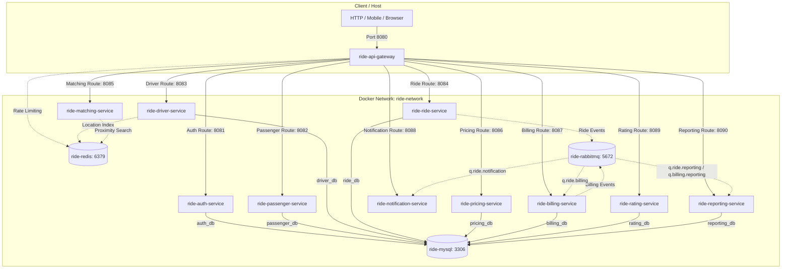

# Phase 8: Multi-Stage Containerization & Local Docker Compose Topology

## 1. Overview & Architecture

Phase 8 provides production-ready containerization and a local container topology for the Online Ride-Hailing DevOps platform. Using **Docker** and **Docker Compose**, the entire microservices ecosystem (11 application services + MySQL 8.0 + Redis 7.2 + RabbitMQ 3.13) can be packaged, configured, and run on a single developer workstation or CI/CD runner.



---

## 2. Multi-Stage Dockerfile Design

All 11 executable microservices are packaged with a production-hardened multi-stage `Dockerfile`:

### Stage 1: Builder
- **Base Image**: `eclipse-temurin:21-jdk-jammy`
- **Context**: Repository root (`context: .`) to accommodate Maven multi-module structure and dependencies on `common-dto` and parent POM.
- **Layer Caching**: Copies all POM files first before source code to maximize Maven dependency caching.
- **Compilation**: Runs `./mvnw -B clean package -pl services/<service-name> -am -DskipTests`.

### Stage 2: Runtime
- **Base Image**: `eclipse-temurin:21-jre-jammy` (minimal non-JDK runtime).
- **Diagnostics**: Installs `curl` to enable standard HTTP health checks for container orchestration.
- **Security**: Creates an unprivileged application user and group `appuser:appgroup` (`UID: 10001`, `GID: 10001`).
- **JVM Container Ergonomics**: Sets `-XX:+UseContainerSupport -XX:MaxRAMPercentage=75.0 -XX:InitialRAMPercentage=50.0 -Djava.security.egd=file:/dev/./urandom`.
- **Zero Secrets**: No tokens, database passwords, or private keys are baked into container image layers.

> [!NOTE]
> `services/common-dto` is a pure Java 21 library containing shared domain events and records. It is not an executable microservice and does not have a runtime container.

---

## 3. Service & Port Matrix

| Container Name | Service | Internal Port | Host Port | Database / Backing Store |
| :--- | :--- | :---: | :---: | :--- |
| `ride-mysql` | MySQL 8.0 Multi-DB | 3306 | `3306` | Persistent volume `ride_mysql_data` |
| `ride-redis` | Redis 7.2 Alpine | 6379 | `6379` | Persistent volume `ride_redis_data` |
| `ride-rabbitmq` | RabbitMQ 3.13 Management | 5672, 15672 | `5672`, `15672` | Persistent volume `ride_rabbitmq_data` |
| `ride-api-gateway` | API Gateway | 8080 | `8080` | Redis token-bucket rate limiting |
| `ride-auth-service` | Auth Service | 8081 | `8081` | MySQL (`auth_db`) |
| `ride-passenger-service` | Passenger Service | 8082 | `8082` | MySQL (`passenger_db`) |
| `ride-driver-service` | Driver Service | 8083 | `8083` | MySQL (`driver_db`), Redis, RabbitMQ |
| `ride-ride-service` | Ride Service | 8084 | `8084` | MySQL (`ride_db`), RabbitMQ |
| `ride-matching-service` | Matching Service | 8085 | `8085` | Redis geospatial, RabbitMQ |
| `ride-pricing-service` | Pricing Service | 8086 | `8086` | MySQL (`pricing_db`) |
| `ride-billing-service` | Billing Service | 8087 | `8087` | MySQL (`billing_db`), RabbitMQ |
| `ride-notification-service`| Notification Service| 8088 | `8088` | RabbitMQ |
| `ride-rating-service` | Rating Service | 8089 | `8089` | MySQL (`rating_db`) |
| `ride-reporting-service` | Reporting Service | 8090 | `8090` | MySQL (`reporting_db`), RabbitMQ |

---

## 4. Database Initialization & Flyway Workflow

1. **Bootstrap Script (`docker/mysql/init-databases.sql`)**:
   Mounted read-only to `/docker-entrypoint-initdb.d/init-databases.sql`.
   On initial MySQL container creation, it executes to create all 8 required database schemas:
   `auth_db`, `passenger_db`, `driver_db`, `ride_db`, `pricing_db`, `billing_db`, `rating_db`, `reporting_db`.
   It grants full schema privileges to user `appuser`.
2. **Schema Migration via Flyway**:
   Each Spring Boot microservice runs Flyway on startup (`spring.flyway.enabled: true`, `spring.flyway.baseline-on-migrate: true`).
   Flyway connects to its assigned schema and executes versioned SQL migrations (`V1__init.sql`) to initialize tables, indexes, and constraints idempotently.

---

## 5. Local Setup & Execution Guide

### Prerequisites
- Docker Engine / Docker Desktop (v24.0+)
- Docker Compose (v2.20+)
- Java 21 LTS & Maven (for host builds)

### Step 1: Environment File Setup
```powershell
# Copy the example environment template
Copy-Item .env.example .env
```
Ensure `.env` contains safe local defaults. Never commit `.env` to source control.

### Step 2: Validate Compose Configuration
```powershell
docker compose config --quiet
```

### Step 3: Build Container Images
```powershell
docker compose build
```

### Step 4: Launch Topology in Background
```powershell
docker compose up -d
```

### Step 5: Verify Health & Status
```powershell
# List all running containers and health status
docker compose ps

# Inspect logs of specific services
docker compose logs -f api-gateway
docker compose logs -f mysql
```

### Step 6: Stop Services Without Data Loss
```powershell
docker compose stop
# or
docker compose down
```

> [!CAUTION]
> **Data Loss Warning**: Running `docker compose down -v` will permanently delete the persistent named volumes (`ride_mysql_data`, `ride_redis_data`, `ride_rabbitmq_data`), resetting all databases, trip histories, and registered users.

---

## 6. Management & Diagnostic Interfaces

- **RabbitMQ Management Dashboard**:
  `http://localhost:15672`
  - Default Username: `guest`
  - Default Password: `guest`
  - Monitor queues: `q.ride.notification`, `q.ride.billing`, `q.ride.reporting`, `q.billing.reporting`, `q.ride.dlq`.
- **API Gateway Actuator Health**:
  `http://localhost:8080/actuator/health`
- **MySQL Direct Access (Development)**:
  `mysql -h 127.0.0.1 -P 3306 -u appuser -papppassword auth_db`
- **Redis CLI (Development)**:
  `redis-cli -h 127.0.0.1 -p 6379 PING`

---

## 7. Security Best Practices

1. **Non-Root Execution**: Every service container runs as unprivileged user `appuser:appgroup` (`UID 10001`), preventing container breakout attacks.
2. **Host Port Isolation**: In production (Kubernetes/ECS), only the API Gateway port (8080) should have an external ingress. Downstream ports (8081-8090) and backing stores (3306, 6379, 5672) are isolated within internal Docker bridge or overlay networks.
3. **Internal DNS Communication**: Microservices communicate using Docker Compose internal DNS names (`mysql`, `redis`, `rabbitmq`, `auth-service`, etc.), never hardcoded IPs or `localhost`.
4. **Header Sanitization**: Untrusted incoming `X-User-*` headers are stripped by the API Gateway before requests reach downstream services.

---

## 8. Automated Testing vs. Live Container Status

- **Automated Verification**: All 12 Maven modules (238 unit and integration tests) execute cleanly with zero test failures using in-memory H2 MySQL mode, Spring Data test contexts, and Mockito reactive mocks.
- **Docker Daemon Availability**: When running in an environment where the Docker engine daemon is not active, `docker compose config` verifies the YAML structure, health check syntax, and volume topology without fabricating live container execution. Live end-to-end container startup is executed when Docker Desktop/Engine is active.
