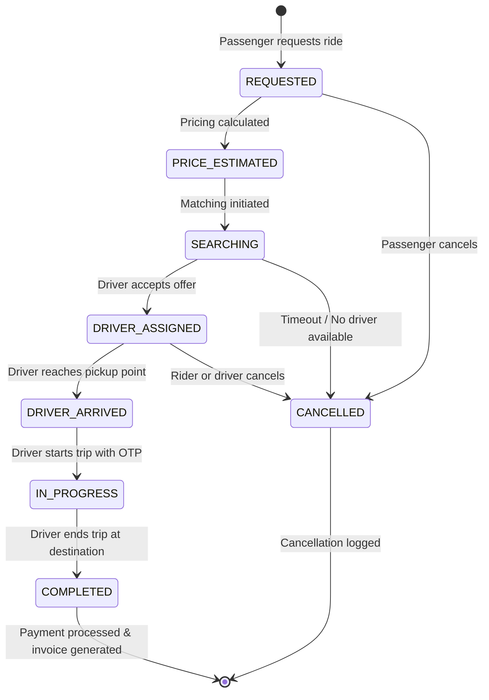

# Project Specification: Ride-Hailing DevOps & Microservices Platform

## 1. Project Goals, Scope & Non-Goals

### 1.1. System Mission & Goals
The **Ride-Hailing DevOps & Microservices Platform** is a distributed, event-driven ride-hailing backend engineered using **Java 21** and **Spring Boot 3.x**. It serves as an enterprise reference implementation demonstrating:
- Cloud-native microservices architecture following the **Database-per-Service** pattern.
- High-concurrency event choreography using **RabbitMQ**.
- Low-latency geospatial driver tracking and candidate discovery using **Redis**.
- Robust operational resilience with circuit breakers, retry templates, dead-letter queues, and idempotent transactions.
- A **local-first** deployment pipeline via Docker Compose and local Kubernetes (`minikube`/`kind`), leading to cloud infrastructure via Terraform and Ansible.
- Production-grade telemetry using **Prometheus**, **Grafana**, **Alertmanager**, and dedicated infrastructure exporters.

### 1.2. In-Scope Domains
1. **Core Ride Lifecycle:** Fare estimation, ride booking, geospatial proximity matching, driver dispatch, trip progress tracking, and trip completion.
2. **Financial Operations:** Idempotent payment processing, billing receipts, and driver payout recording.
3. **User & Identity Management:** Role-based access control (`ROLE_PASSENGER`, `ROLE_DRIVER`, `ROLE_ADMIN`), BCrypt credential hashing, and JWT token issuance.
4. **Asynchronous Communications:** Customer notifications (SMS, Email, Push simulations) and WebSocket real-time driver tracking.
5. **Quality & Reputation:** Post-trip driver and passenger rating feedback and reputation scoring.
6. **Analytics & BI:** Aggregated operational reporting and KPI dashboards.

### 1.3. Explicit Non-Goals
- Real money banking integration (payments are simulated with strict idempotency and transaction ledgers).
- Native iOS/Android client binary compilation (APIs expose standard REST and WebSocket endpoints for web/mobile consumption).
- Autonomous execution of cloud-costly infrastructure (AWS Terraform provisioning strictly requires human authorization).

---

## 2. Core Architectural & Technology Decisions

| Technology | Role in System | Justification |
| :--- | :--- | :--- |
| **Java 21 (LTS)** | Backend Language | Project Loom Virtual Threads, Pattern Matching, Java Records for immutable DTOs, enhanced garbage collection |
| **Spring Boot 3.x** | Application Framework | Jakarta EE 10 baseline, Spring Cloud Gateway, Spring Data JPA, Spring AMQP, native Micrometer metrics |
| **Apache Maven** | Multi-Module Build Tool | Strict submodule isolation, centralized dependency management, automated build verification |
| **MySQL 8.x** | Relational Persistence | ACID guarantees, transactional isolation, schema evolution per microservice boundary |
| **Redis 7.x** | Geospatial & Cache | Native `GEOADD`/`GEOSEARCH` geospatial indices, high-throughput TTL heartbeat caching, gateway token bucket rate limiting |
| **RabbitMQ 3.x** | Sole Message Broker | Topic exchanges, dead-letter exchanges (DLX), exponential backoff retries, AMQP 0-9-1 reliable delivery |
| **Docker & Compose** | Local Containerization | Multi-stage Java 21 builds, non-root runtimes, single-command full-topology local execution |
| **Kubernetes** | Orchestration | Local-first deployment (`minikube`/`kind`), declarative manifests, Kustomize overlays, HPA, liveness/readiness probes |
| **GitHub Actions** | Sole CI/CD Platform | Automated build, Checkstyle linting, unit/integration test execution, container image packaging with Java 21 runners |
| **Terraform & Ansible** | IaC & Configuration | Modular cloud/local infrastructure declarations, automated server hardening and runtime provisioning |
| **Prometheus & Grafana** | Observability Suite | Metric scraping, Alertmanager alerting rules, infrastructure exporters, JVM and business KPI dashboards |

---

## 3. Microservices Domain Boundaries & Service Scope

The system consists of **11 application microservices** and **1 common module**:

```
                                  ┌────────────────────────┐
                                  │   API Gateway (:8080)  │
                                  └───────────┬────────────┘
         ┌───────────────────┬────────────────┼────────────────┬───────────────────┐
         │                   │                │                │                   │
  ┌──────▼─────┐      ┌──────▼──────┐  ┌──────▼──────┐  ┌──────▼──────┐     ┌──────▼──────┐
  │Auth Service│      │  Passenger  │  │   Driver    │  │    Ride     │     │   Pricing   │
  │  (:8081)   │      │Service :8082│  │Service :8083│  │Service :8084│     │Service :8086│
  └────────────┘      └─────────────┘  └─────────────┘  └──────┬──────┘     └─────────────┘
                                                               │
                                                   RabbitMQ Topic Exchange
                                     ┌─────────────────────────┼─────────────────────────┐
                              ┌──────▼──────┐           ┌──────▼──────┐           ┌──────▼──────┐
                              │  Matching   │           │   Billing   │           │Notification │
                              │Service :8085│           │Service :8087│           │Service :8088│
                              └─────────────┘           └─────────────┘           └─────────────┘
                                                               │
                                                 ┌─────────────┴─────────────┐
                                          ┌──────▼──────┐             ┌──────▼──────┐
                                          │   Rating    │             │  Reporting  │
                                          │Service :8089│             │Service :8090│
                                          └─────────────┘             └─────────────┘
```

### 3.1. API Gateway (`services/api-gateway`, Port `8080`)
- **Technology:** Spring Cloud Gateway (Reactive / Spring WebFlux).
- **Data Ownership:** Redis (token bucket rate limiting counters).
- **Responsibilities:**
  - Single external entry point for clients (HTTP/REST, WebSocket proxying).
  - Validates inbound JWTs, verifies cryptographic signature, checks expiration.
  - Sanitizes and injects downstream headers: `X-User-Id`, `X-User-Email`, `X-User-Role`.
  - Enforces per-client rate limits using Redis token buckets.
  - Applies Resilience4j circuit breakers with graceful fallback responses.

### 3.2. Authentication & Identity Service (`services/auth-service`, Port `8081`)
- **Technology:** Spring Boot 3.x, Spring Security, JWT (Nimbus/jjwt), Spring Data JPA.
- **Database Ownership:** MySQL `auth_db`.
- **Responsibilities:**
  - User registration with BCrypt password hashing (cost factor 12).
  - Manages system roles: `ROLE_PASSENGER`, `ROLE_DRIVER`, `ROLE_ADMIN`.
  - Issues signed HMAC-SHA256 / RSA JWT access tokens and manages refresh token lifecycles.
  - Planned APIs: `POST /api/v1/auth/register`, `POST /api/v1/auth/login`, `POST /api/v1/auth/refresh`.

### 3.3. Passenger Service (`services/passenger-service`, Port `8082`)
- **Technology:** Spring Boot 3.x, Spring Data JPA.
- **Database Ownership:** MySQL `passenger_db`.
- **Responsibilities:**
  - Manages passenger personal profiles, default payment preferences, emergency contacts.
  - Maintains passenger trip logs and aggregate ride counts.
  - Planned APIs: `GET /api/v1/passengers/me`, `PUT /api/v1/passengers/me`, `GET /api/v1/passengers/me/trips`.

### 3.4. Driver Service (`services/driver-service`, Port `8083`)
- **Technology:** Spring Boot 3.x, Spring Data JPA, Spring Data Redis.
- **Database & Cache Ownership:** MySQL `driver_db` + Redis (`drivers:available` geospatial set).
- **Responsibilities:**
  - Driver onboarding, vehicle registration (make, model, license plate), document approval status.
  - Manages driver status: `OFFLINE`, `AVAILABLE`, `ON_TRIP`.
  - Ingests high-frequency driver GPS coordinates: `POST /api/v1/drivers/location`.
  - Updates Redis geospatial index (`GEOADD`) and sets a 60-second TTL availability heartbeat key (`driver:heartbeat:<id>`).
  - Automatically evicts stale drivers whose heartbeat has expired.

### 3.5. Ride Management Service (`services/ride-service`, Port `8084`)
- **Technology:** Spring Boot 3.x, Spring Data JPA, Spring AMQP.
- **Database Ownership:** MySQL `ride_db`.
- **Responsibilities:**
  - Core orchestrator of the Ride Lifecycle Finite State Machine (FSM).
  - Coordinates initial fare estimation with `pricing-service`.
  - Persists trip entities: `id`, `passenger_id`, `driver_id`, pickup/dropoff coordinates, fare, and status.
  - Publishes domain events to RabbitMQ: `ride.requested`, `ride.started`, `ride.completed`, `ride.cancelled`.
  - Planned APIs: `POST /api/v1/rides/request`, `POST /api/v1/rides/{id}/accept`, `POST /api/v1/rides/{id}/start`, `POST /api/v1/rides/{id}/complete`, `POST /api/v1/rides/{id}/cancel`.

### 3.6. Matching Service (`services/matching-service`, Port `8085`)
- **Technology:** Spring Boot 3.x, Spring Data Redis, Spring AMQP.
- **Data Store:** Redis (reads geospatial driver locations).
- **Responsibilities:**
  - Consumes `ride.requested` event from RabbitMQ (`q.ride.matching`).
  - Executes Redis `GEOSEARCH` to locate online, non-stale drivers within a 5 km radius of pickup coordinates.
  - Ranks candidates by proximity and rating, selects candidate driver.
  - Publishes `ride.matched` event or triggers retry/timeout if no driver is available.

### 3.7. Pricing Service (`services/pricing-service`, Port `8086`)
- **Technology:** Spring Boot 3.x, Spring Data JPA.
- **Database Ownership:** MySQL `pricing_db`.
- **Responsibilities:**
  - Calculates dynamic trip fares: `Fare = (Base Fare + (Distance * Rate/km) + (Duration * Rate/min)) * Surge Multiplier`.
  - Maintains geographic pricing zones and dynamic surge multiplier tables.
  - Planned APIs: `POST /api/v1/pricing/estimate`, `GET /api/v1/pricing/surge-zone/{zoneId}`.

### 3.8. Billing & Payment Service (`services/billing-service`, Port `8087`)
- **Technology:** Spring Boot 3.x, Spring Data JPA, Spring AMQP.
- **Database Ownership:** MySQL `billing_db`.
- **Responsibilities:**
  - Consumes `ride.completed` domain events from RabbitMQ (`q.ride.billing`).
  - Executes **idempotent payment transactions**:
    - Generates or receives `idempotency_key` (e.g., `PAY-RIDE-<rideId>`).
    - Enforces uniqueness via MySQL database constraint `UNIQUE(idempotency_key)`.
    - Handles retries gracefully without double-charging.
  - Produces immutable invoice ledgers and emits `billing.payment_processed`.

### 3.9. Notification Service (`services/notification-service`, Port `8088`)
- **Technology:** Spring Boot 3.x, Spring AMQP, Spring WebSocket (STOMP).
- **Data Store:** In-memory WebSocket connection registry.
- **Responsibilities:**
  - Subscribes to `ride.*` and `billing.*` domain events from RabbitMQ.
  - Dispatches simulated SMS, push notifications, and email receipts.
  - Maintains WebSocket sessions (`/ws/rides/{id}`) for real-time live coordinate and state updates to passenger and driver client apps.

### 3.10. Rating Service (`services/rating-service`, Port `8089`)
- **Technology:** Spring Boot 3.x, Spring Data JPA, Spring AMQP.
- **Database Ownership:** MySQL `rating_db`.
- **Responsibilities:**
  - Collects post-trip ratings (1 to 5 stars) and feedback comments from passengers and drivers.
  - Computes rolling average ratings for drivers and passengers.
  - Planned APIs: `POST /api/v1/ratings`, `GET /api/v1/ratings/drivers/{id}/summary`.

### 3.11. Reporting & Analytics Service (`services/reporting-service`, Port `8090`)
- **Technology:** Spring Boot 3.x, Spring Data JPA, Spring AMQP.
- **Database Ownership:** MySQL `reporting_db`.
- **Responsibilities:**
  - Subscribes to all domain events via RabbitMQ topic wildcard (`ride.*`, `billing.*`).
  - Populates denormalized reporting schemas and data marts.
  - Planned APIs: `GET /api/v1/reports/daily-summary`, `GET /api/v1/reports/driver-performance`.

### 3.12. Common Module (`services/common-dto`)
- **Technology:** Java 21 Maven Library Module.
- **Responsibilities:**
  - Shared immutable Java 21 Records (DTOs) for API contracts and domain events.
  - Standard event envelopes (`eventId`, `eventType`, `timestamp`, `traceId`, `payload`).
  - Common error response models (`ApiErrorResponse`), status enums, and utility constants.

---

## 4. Ride Lifecycle Finite State Machine (FSM)

The trip lifecycle is governed by strict state transitions. Invalid transitions throw domain exceptions and are rejected.



### Transition Rules:
- A ride in `IN_PROGRESS` cannot be cancelled by passenger self-service.
- A ride cannot transition to `IN_PROGRESS` without the driver having arrived (`DRIVER_ARRIVED`).
- Reaching `COMPLETED` transitions the ride to a terminal, immutable state and triggers billing.

---

## 5. Asynchronous Messaging Architecture (RabbitMQ)

### 5.1. Exchanges & Routing Key Patterns
| Exchange | Type | Routing Key Pattern | Bound Queues | Target Service |
| :--- | :--- | :--- | :--- | :--- |
| `ride.topic.exchange` | Topic | `ride.requested` | `q.ride.matching` | `matching-service` |
| `ride.topic.exchange` | Topic | `ride.*` | `q.ride.notification` | `notification-service` |
| `ride.topic.exchange` | Topic | `ride.completed` | `q.ride.billing` | `billing-service` |
| `ride.topic.exchange` | Topic | `ride.*` | `q.ride.reporting` | `reporting-service` |
| `billing.direct.exchange` | Direct | `billing.processed` | `q.billing.reporting` | `reporting-service` |
| `dlx.topic.exchange` | Topic | `dlx.#` | `q.dead-letter` | DLQ Triage / Alerting |

### 5.2. Retry & Dead-Letter Handling
- All queues declare:
  - `x-dead-letter-exchange`: `dlx.topic.exchange`
  - `x-dead-letter-routing-key`: `dlx.failed`
- **Consumer Retry Policy:** Spring AMQP retry interceptor attempts up to 3 deliveries with exponential backoff (initial interval: 1000ms, multiplier: 2.0, max: 10000ms).
- If all 3 attempts fail, the message is acknowledged to clear the worker queue and routed to `q.dead-letter` for operator inspection.

---

## 6. Real-Time Geospatial Driver Matching (Redis)

1. **Driver Ingestion:**
   Online drivers send location pings every 5 seconds.
   ```redis
   GEOADD drivers:available <longitude> <latitude> <driver_id>
   ```
2. **Heartbeat & Stale Eviction:**
   Each coordinate update sets a key with a 60-second TTL:
   ```redis
   SETEX driver:heartbeat:<driver_id> 60 "ONLINE"
   ```
   If a driver loses network without toggling offline, the heartbeat key expires. Matching checks verify the heartbeat key exists; drivers without active heartbeats are evicted from `drivers:available`.
3. **Proximity Search:**
   When a ride is requested at pickup `(lat, lng)`:
   ```redis
   GEOSEARCH drivers:available FROMLONLAT <lng> <lat> BYRADIUS 5 km ASC WITHDIST WITHCOORD COUNT 10
   ```

---

## 7. Idempotent Payment Processing Requirements

1. **Idempotency Key:** Every payment operation requires an `idempotency_key` passed in the event payload (e.g. `PAY-RIDE-<ride_id>`).
2. **Database Constraint:**
   ```sql
   CREATE TABLE payment_transactions (
       id BIGINT AUTO_INCREMENT PRIMARY KEY,
       idempotency_key VARCHAR(64) NOT NULL UNIQUE,
       ride_id BIGINT NOT NULL,
       passenger_id BIGINT NOT NULL,
       amount DECIMAL(10, 2) NOT NULL,
       status VARCHAR(20) NOT NULL,
       transaction_ref VARCHAR(64),
       created_at TIMESTAMP DEFAULT CURRENT_TIMESTAMP,
       updated_at TIMESTAMP DEFAULT CURRENT_TIMESTAMP ON UPDATE CURRENT_TIMESTAMP
   );
   ```
3. **Idempotency Flow:**
   - Query `SELECT * FROM payment_transactions WHERE idempotency_key = ?`.
   - If found with `status = 'SUCCESS'`, return existing receipt (HTTP 200) without charging again.
   - If not found, insert record with `PENDING`, invoke payment simulation, and update to `SUCCESS` or `FAILED`.
   - Concurrent duplicates attempting insertion trigger `DuplicateKeyException` and safely load the winning transaction record.

---

## 8. Observability, Health & Business KPIs

### 8.1. Endpoints
- `/actuator/health/liveness`: Process liveness probe for Kubernetes.
- `/actuator/health/readiness`: Verifies connection to MySQL, Redis, and RabbitMQ.
- `/actuator/prometheus`: OpenMetrics endpoint scraped by Prometheus.

### 8.2. Business KPIs & Custom Metrics
| Metric Name | Type | Labels | Description |
| :--- | :--- | :--- | :--- |
| `rides_requested_total` | Counter | `city`, `tier` | Total ride booking requests initiated |
| `rides_completed_total` | Counter | `city`, `driver_id` | Total successfully completed trips |
| `matching_duration_seconds` | Histogram | `city` | Time taken from request to driver assignment |
| `payment_failures_total` | Counter | `reason` | Total payment charge failure events |
| `active_drivers_count` | Gauge | `city` | Real-time count of online, available drivers |

### 8.3. Infrastructure Exporters
- `mysqld_exporter` (port 9104): Queries, buffer pool, connection count.
- `redis_exporter` (port 9121): Memory usage, commands/sec, connected clients.
- `rabbitmq_exporter` (port 15692): Queue depths, unacked messages, consumer rates.
- `node_exporter` (port 9100): CPU, RAM, disk I/O, network traffic.
- `cadvisor` (port 8080): Container CPU throttling, memory limits.

---

## 9. Security, Governance & Implementation Status

1. **Security Posture:**
   - Zero-trust internal communication: Internal microservices validate `X-User-Id` and `X-User-Role` headers injected by the trusted API Gateway.
   - BCrypt hashing for credentials; JWT tokens signed with cryptographic keys.
   - Secrets are excluded from version control; local templates provided via `.env.example`.
2. **Cloud Governance:**
   - Local-first development precedes any cloud deployments.
   - Cloud provisioning with Terraform requires human authorization. Automated execution of `terraform apply` or `terraform destroy` is prohibited.
3. **Implementation Status:**
   - Current status: **Phase 0 (Planning Baseline)**.
   - No application source code or build artifacts exist yet.
   - All documented APIs, entities, and pipelines represent system requirements to be implemented according to `docs/IMPLEMENTATION_PLAN.md`.
